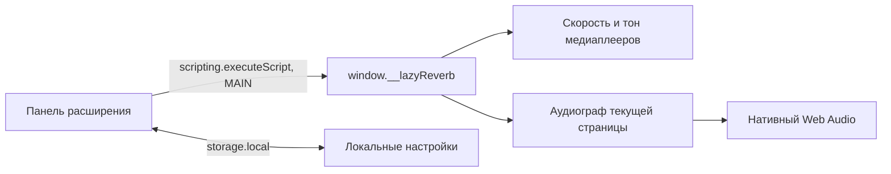
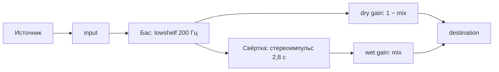

# Архитектура Lazy Reverb

## Поток управления

`manifest.json` ограничивает сайты и загружает `engine.js` в `MAIN` на `document_start`. Это позволяет обнаружить скрытые плееры и соединения Web Audio, которые сайт создаёт при запуске. Фонового скрипта нет.

`popup.js` проверяет адрес активной вкладки и передаёт параметры через `browser.scripting.executeScript`. Очередь с номером ревизии пропускает устаревшие изменения ползунков. Применённые параметры сохраняются в `storage.local`; включение не переносится в новые вкладки. `browser.commands` показывает и переназначает фактическую горячую клавишу панели.

Странице доступен только `window.__lazyReverb.get()/set()` для её собственного эффекта. Движок повторно проверяет типы и диапазоны параметров. API расширений, хранилище и разрешения остаются в панели.

## Аудиограф

Для обычного HTML-плеера скорость меняется через `playbackRate`, а изменение тона включается через `preservesPitch = false`. При необходимости DSP движок создаёт один `MediaElementAudioSourceNode`. Для графа сайта перехватываются конечные соединения с `AudioContext.destination`; промежуточные соединения не меняются. Один rack обслуживает один контекст.

При басе 0 дБ фильтр обходится. При реверберации 0 % ветка свёртки отсоединена, `buffer = null`. Узлы создаются лениво и повторно используются; перестройка соединений нужна только при включении или выключении ветки. Изменения усиления сглаживаются через `setTargetAtTime`.

Бас усиливается без автоматического ослабления сигнала. На громком исходнике возможен клиппинг; отдельного дисторшна или компрессора нет. При выключении эффектов остаётся `input → dry → destination` с единичным усилением.

## Обнаружение и владение ресурсами

- `play()`, события `play`, `loadedmetadata` и `ratechange` обнаруживают плееры и поддерживают выбранную скорость. Поиск DOM выполняется при включении, без polling и глобального наблюдателя.
- `WeakMap` хранит метаданные плееров и rack. Наборы `WeakRef` позволяют перечислять живые записи и удалять пустые ссылки, не удерживая объекты от сборки мусора.
- Остановленный и отсоединённый от DOM плеер выходит из активного реестра. Его исходные скорость и тон восстанавливаются; собственный источник расширения отсоединяется. Играющий скрытый плеер сохраняется.
- Слабые метаданные собственного источника позволяют восстановить соединение при повторном `play()`, даже если эффекты уже выключены. Повторное создание источника для того же HTML-элемента запрещено браузером.
- Сайт владеет своими источниками и контекстами. Очистка расширения не закрывает их и не разрушает их соединения. Один собственный `mediaContext` сохраняется до перезагрузки страницы, чтобы захваченные плееры не теряли звук.

## Границы совместимости

Перед захватом HTML-плеера проверяются DRM и происхождение потока. Поток без CORS остаётся на исходном пути со сменой скорости. `OfflineAudioContext` не перехватывается. Соединение и отсоединение `destination` перенаправляются согласованно.

Удаление дополнения не выгружает код из уже открытого `MAIN`-контекста. После удаления, обновления или отключения дополнения музыкальную вкладку нужно обновить.

## Где проверяется поведение

| Уровень | Что доказывает |
| --- | --- |
| Модульные тесты | Проверка параметров, очередь UI, владение ресурсами, сборка мусора, отсутствие роста графа |
| Playwright | Работа исходного UI и движка на локальных страницах с тестовым мостом API расширений |
| Нативный Zen smoke | Установка дополнения, настоящая свёртка и фильтр, освобождение буфера, API горячих клавиш, размер панели |
| Нативный входной сценарий WebdriverIO | Временная установка ZIP, автоматический `MAIN` bootstrap, настоящий документ панели и `scripting.executeScript` в активной вкладке Firefox 159 и Zen 1.24.3b |
| Локальный performance-гейт | CPU/PSS синтетического DSP и возврат после выключения с контролем шума |
| Ручная проверка | Нажатие хоткея на рабочем столе, звук и совместимость с текущими плеерами сервисов |

GeckoDriver поднимает отдельный временный профиль. BiDi подставляет локальные HTML и WAV до навигации и прерывает остальные HTTP(S)-запросы. Selenium и собственный транспорт Marionette для этого пути не используются. Музыкальная вкладка создаётся явно: стартовая вкладка Zen может отсутствовать в `tabs.query`. GeckoDriver загружает документ установленной панели в фоновую вкладку, а BiDi обращается к её контексту. Открытие панели через значок и физическое сочетание проверяются вручную.
