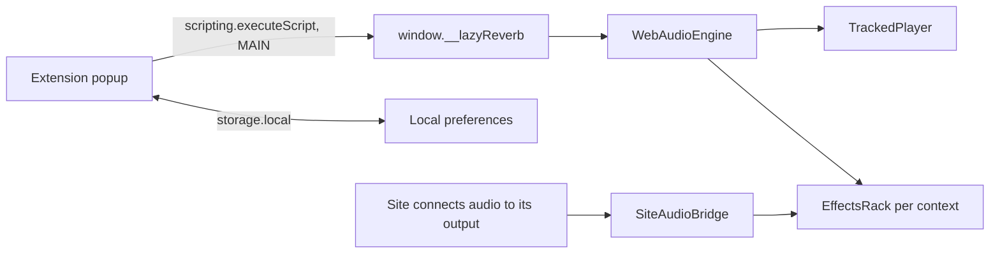
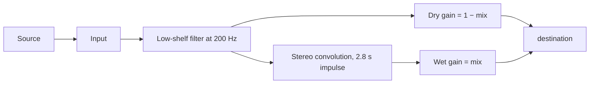

# Lazy Reverb architecture

## Control flow

WXT generates a Manifest V3 file for each target. The content entry loads the engine in `MAIN` at `document_start` on supported sites. This lets the engine see detached players and Web Audio connections created during page startup. There is no background script.

`src/popup.ts` checks the active tab's URL and sends settings through `browser.scripting.executeScript`. A revision counter in the queue skips obsolete slider changes. The popup stores the applied preferences in `storage.local`. Each page keeps its own enabled flag. `src/shortcuts.ts` reads the registered binding and exposes the available edit action. Firefox updates the binding through the commands API. Chromium opens its built-in shortcut settings. Additional shortcut behavior is tracked under `improve-extension-shortcuts`.

The page can call `window.__lazyReverb.get()/set()` for its own effects. The engine validates input types and ranges. Extension APIs, storage, and permissions stay in the popup.

## Audio graph

For an ordinary HTML player, `TrackedPlayer` saves its original settings, applies `playbackRate`, and uses `preservesPitch = false`. When DSP is needed, the engine asks a media adapter for one `MediaElementAudioSourceNode`. The same adapter handles resuming a context.

`SiteAudioBridge` redirects connections to `AudioContext.destination` into the engine's one `EffectsRack` per context. The bridge preserves intermediate connections and supplies the original native methods for wiring the rack.

The rack also works in an ordinary Web Audio graph. Pass a context and a destination node, then connect a source to its input. The rack owns its effect nodes and can release them while the owner's context and output remain available.

At 0 dB bass, the graph bypasses the filter. At 0% reverb, it disconnects the convolution branch and clears the buffer. The engine creates nodes on demand, reuses them, and rewires the graph only when a branch is enabled or disabled. Gain changes use `setTargetAtTime` for smoothing.

Bass boost applies without automatic gain compensation. Loud signals may clip. The output has no added distortion stage or compressor. Turning the effects off leaves `input → dry → destination` at unity gain. When the graph is created, `input` copies `channelCount`, `channelCountMode`, and `channelInterpretation` from the output. This applies the output's channel conversion to each connection before the signals are summed.

## Discovery and resource ownership

- The `play()` wrapper and the `play`, `loadedmetadata`, and `ratechange` events discover players and maintain the selected speed. A DOM scan runs on enable. There is no polling or global observer.
- `WeakMap` holds player and rack metadata. Sets of `WeakRef` let the engine iterate live records and drop empty entries without preventing garbage collection.
- A paused player detached from the DOM leaves the active registry. The engine restores its original rate and pitch and disconnects any extension-owned source. A detached player that is still playing stays registered.
- Weak metadata lets a later `play()` reconnect an extension-owned source, including in bypass. The browser allows one source node per HTML media element.
- Sites own their sources and contexts. Cleanup preserves them and their connections. The extension retains one `mediaContext` until page reload so routed players keep their audio.

## Compatibility

The engine checks DRM and stream origin before routing HTML players into Web Audio. Streams without CORS stay on their original route with rate control available. The hooks leave `OfflineAudioContext` alone and redirect both connection and disconnection of `destination` consistently.

An already loaded MAIN script stays in its document when the extension is removed, updated, or disabled. Reload music tabs to start a fresh document.

## Verification

| Level | Coverage |
| --- | --- |
| Unit tests | Parameter validation, UI queue, resource ownership, garbage collection, and graph size |
| Native WebdriverIO scenarios | ZIP installation, automatic MAIN startup, real `storage`, `scripting`, and `commands`, tab isolation, SPA changes, CORS, and keyboard controls in Firefox 159 and Zen 1.24.3b |
| Native signal check | Measures the output path of the detached test player and verifies dry output, bass gain, wet tail, impulse release, and restoration of the original signal. It also compares bypass for mixed mono and 5.1 sources with a direct stereo reference on load and after toggling effects. |
| Local performance gate | Synthetic DSP CPU/PSS and post-bypass measurements with noise detection |
| Manual checks | Physical shortcut, audio, and compatibility with current service players |

GeckoDriver launches a temporary browser profile. BiDi serves local HTML and WAV and aborts other HTTP(S) requests before navigation. Tests explicitly create the music tab because Zen's startup tab may be absent from `tabs.query`. GeckoDriver loads the installed popup document in a background tab, and BiDi addresses its context. Opening the popup from the toolbar and pressing the physical shortcut are manual checks.

The DSP fixture uses one context and source. BiDi checks the clock, signal, and effect activity before and after each phase. The Linux sampler tracks the browser and its descendants by PID and start time. The gate validates raw CPU/PSS samples before comparing them with the budgets. In method 2, phase PSS is the median of four samples. CI uses numeric fixtures. The local Zen measurement excludes HTML decoding and full service-page load.
